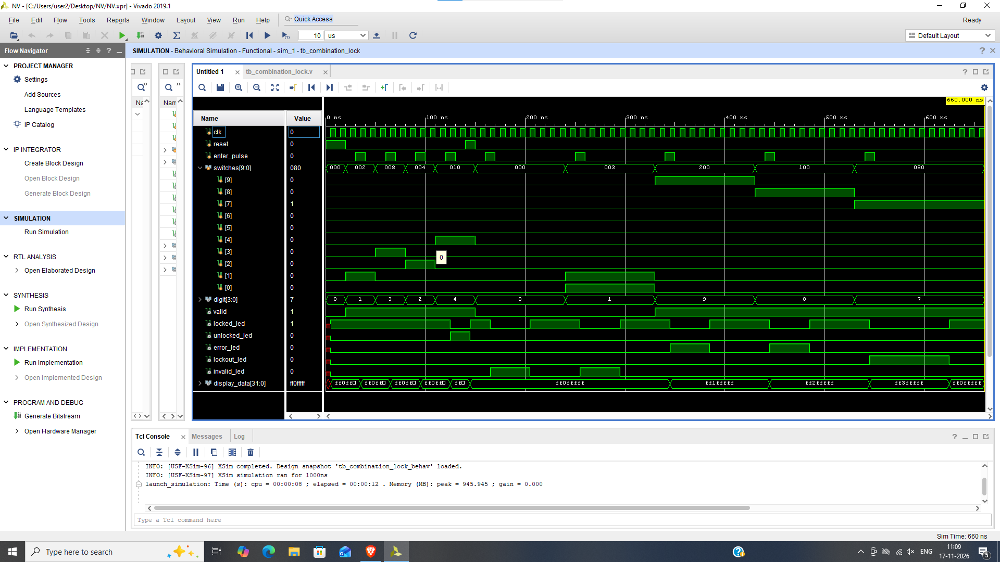
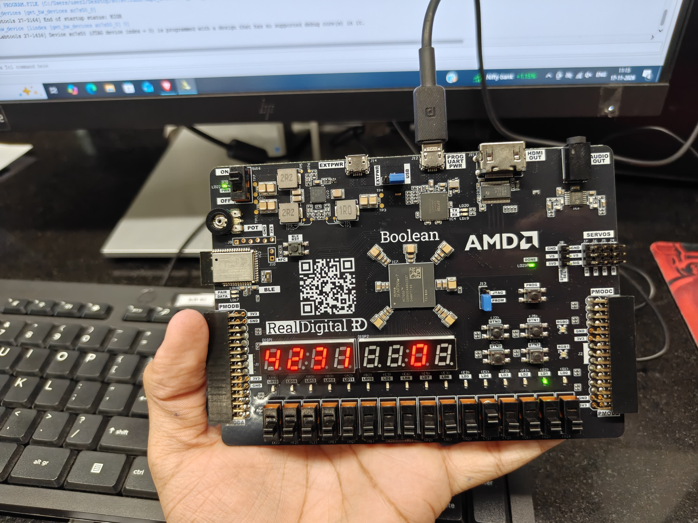

# Digital Combination Lock (Verilog + FPGA)

A finite-state-machine based combination lock for the **RealDigital Boolean board** (Spartan-7 XC7S50, part `xc7s50csga324-1`). The design was simulated, implemented in Vivado and demonstrated on the physical board.

## Password
**1 → 3 → 2 → 4**

Select each digit using one-hot slide switches (exactly one of SW0–SW9 ON) and press ENTER.

## Features
- One-hot switch decoder with invalid-selection detection (zero-hot or multi-hot)
- FSM-based sequential password checking
- Correct password unlocks the system until reset
- A wrong digit clears partial progress and increments the failed-attempt counter
- Three wrong attempts trigger a 5-second lockout; the counter resets when the lockout expires
- Invalid switch patterns are reported separately: they do not count as failures and do not clear partial progress
- Synchronized and debounced ENTER button
- Status LEDs and two multiplexed four-digit seven-segment displays

## Demo
| Simulation waveform | Running on the Boolean board |
|---|---|
|  |  |

## Repository structure
```text
Boolean_Combination_Lock/
├── README.md                     This file
├── .gitignore                    Ignores Vivado-generated files
├── rtl/                          Synthesizable Verilog
│   ├── boolean_lock_top.v        Board top level
│   ├── button_conditioner.v      Synchronizer, debounce, edge pulse
│   ├── digit_decoder.v           One-hot switch decoder + valid flag
│   ├── combination_lock_core.v   Password FSM, attempts, timers
│   └── sevenseg_scan4.v          Multiplexed seven-segment driver
├── sim/
│   └── tb_combination_lock.v     Behavioral testbench (simulation only)
├── constraints/
│   └── boolean_lock.xdc          Boolean board pin constraints
├── bitstream/                    Generated .bit file
└── docs/
    ├── IMPLEMENTATION_GUIDE.md   Step-by-step Vivado and board instructions
    ├── Project_Report.docx       Full project report
    └── images/                   Waveform and board photos
```

## Board I/O
| Signal | Function |
|---|---|
| SW[9:0] | One-hot digit selection; SW0 = 0 … SW9 = 9 (SW[15:10] unused) |
| BTN0 | Reset (clears progress, attempts **and** any active lockout) |
| BTN1 | Enter |
| LED0 | Locked |
| LED1 | Unlocked |
| LED2 | Wrong digit (250 ms) |
| LED3 | Lockout (5 s) |
| LED4 | Invalid selection (250 ms) |
| D0 | Entered digits; unentered positions blank. The first digit entered goes to the `AN0` position |
| D1 | Attempt counter (0–3) on the `AN1` position |

**Timing at 100 MHz:** debounce 10 ms, error/invalid indication 250 ms, lockout 5 s. ENTER presses are ignored during the error, invalid and lockout windows.

**Button polarity:** the top level assumes active-HIGH buttons (`BUTTON_ACTIVE_LOW=0`), as on the Boolean board. Seven-segment segments and digit enables are active-LOW.

## Quick start
1. Create a Vivado RTL project for part `xc7s50csga324-1`.
2. Add `rtl/*.v` as design sources, `constraints/boolean_lock.xdc` as constraints and `sim/tb_combination_lock.v` as a simulation source.
3. **Simulate:** set `tb_combination_lock` as simulation top and run behavioral simulation; it prints `ALL TESTS PASSED`.
4. **Build:** set `boolean_lock_top` as design top, then run Synthesis → Implementation → Generate Bitstream.
5. **Program:** connect the board to the PROG UART port and program the bitstream from Hardware Manager.

Full details: [`docs/IMPLEMENTATION_GUIDE.md`](docs/IMPLEMENTATION_GUIDE.md). The complete write-up (design, FSM, test results, implementation results) is in [`docs/Project_Report.docx`](docs/Project_Report.docx).

## Known limitations
- **BTN0 defeats the lockout:** reset clears the attempt counter and any active lockout.
- **Per-digit feedback:** a wrong digit is reported immediately and correct digits are shown, so each position can be guessed separately (at most 36 wrong guesses instead of 10,000 combinations).
- **Password is hard-coded** as `1-3-2-4` in `combination_lock_core.v`.
- **Reset is not synchronized:** BTN0 drives the synchronous reset directly.
- **Power-up display:** the digit registers have no initial value, so D0 may show `0000` until BTN0 is pressed once after programming.

These are acceptable for a classroom demonstration; the report lists suggested improvements.


## Architecture:
                    PHYSICAL INPUTS
                    ┌──────────────────────────┐
                    │                          │
                    Slide Switches              ENTER Button
                    (SW[9:0])                    (BTN1)
                    │                          │
                    ▼                          ▼
                    ┌──────────────┐        ┌──────────────────┐
                    │ Digit Decoder│        │ Button Conditioner│
                    │              │        │                  │
                    │ One-hot to   │        │ Synchronization  │
                    │ Binary Digit │        │ + Debouncing     │
                    │              │        │ + Pulse Generation│
                    └──────┬───────┘        └────────┬─────────┘
                    │                         │
                    │ digit, valid            │ enter_pulse
                    │                         │
                    └────────────┬────────────┘
                          ▼
                    ┌─────────────────────┐
                    │ Combination Lock   │
                    │ Core (FSM)         │
                    │                     │
                    │ • Password Checking │
                    │ • Position Tracking │
                    │ • Attempt Counter   │
                    │ • Error Timer       │
                    │ • Lockout Timer     │
                    └──────────┬──────────┘
                           │
                    Status & Display Data
                           │
                    ┌─────────┴──────────┐
                    ▼                    ▼
                    ┌──────────────┐    ┌─────────────────┐
                    │ LED Control  │    │ Seven-Segment   │
                    │              │    │ Display Driver  │
                    └──────┬───────┘    └────────┬────────┘
                    │                     │
                    ▼                     ▼
                    FPGA LEDs            7-Segment Display
## Notes
The testbench is simulation-only and is not part of the bitstream. It uses `$fatal`; if your Vivado version rejects that in a `.v` file, set the file type to SystemVerilog.


